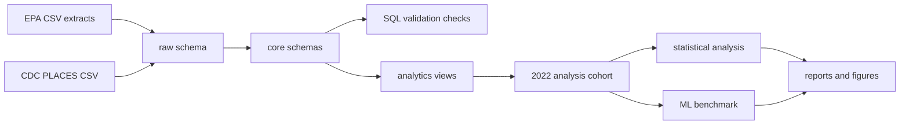
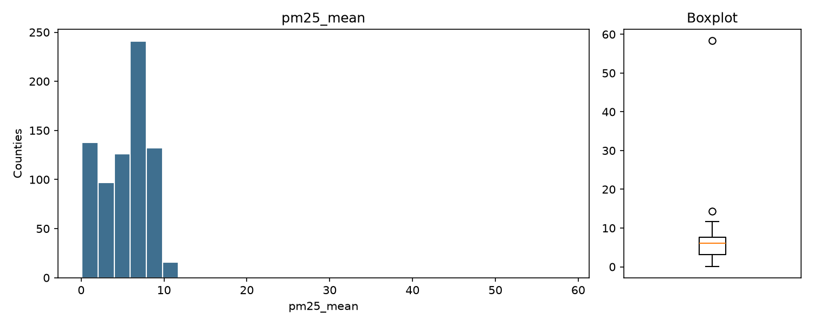
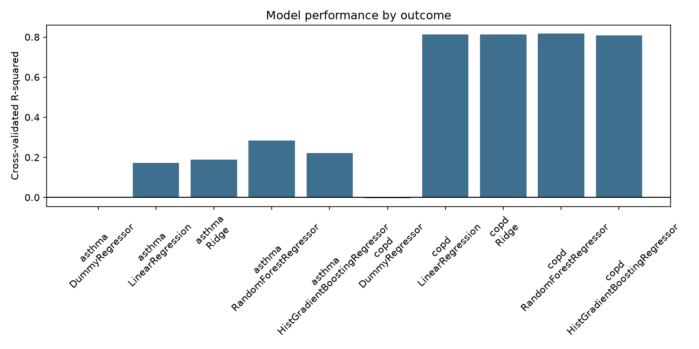
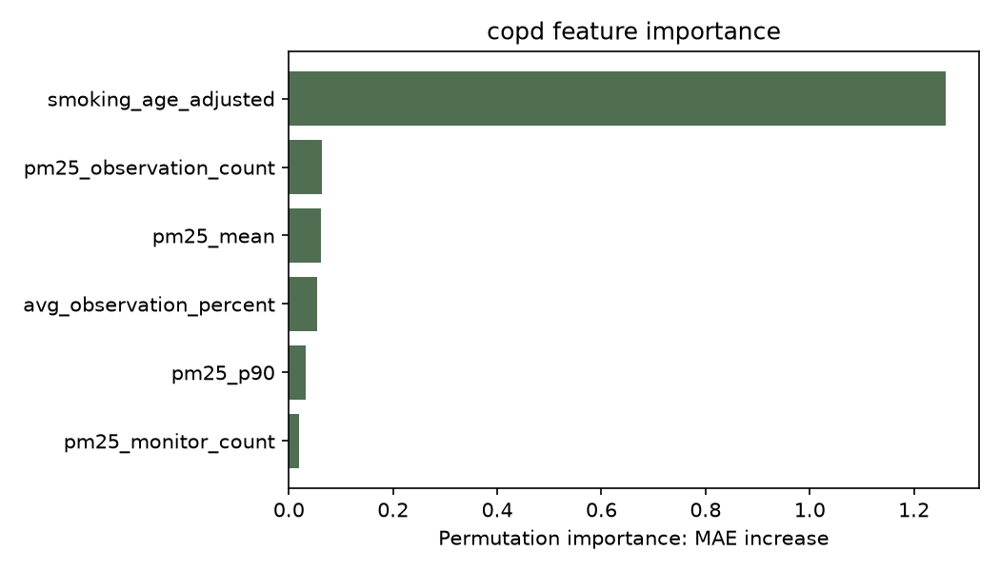

# Envirohealth Pipeline

[](https://github.com/raymondblahajr/Envirohealth-pipeline/actions/workflows/ci.yml)

Envirohealth Pipeline is a portfolio data engineering and applied analytics project that integrates EPA air quality data with CDC PLACES county health indicators. It builds a reproducible PostgreSQL pipeline from raw public datasets into validated analytical views, then uses those views for statistical analysis and predictive machine learning benchmarks.

## Problem

County-level public health analysis often requires joining environmental exposures, monitoring coverage, and health outcomes from separate public data systems. This project asks a focused question:

> Among U.S. counties with available EPA PM2.5 monitoring data in 2022, is annual mean PM2.5 associated with age-adjusted adult asthma and COPD prevalence?

The goal is not to claim causality. The goal is to build a defensible, reproducible analytical pipeline that makes data coverage, joins, validation, and modeling assumptions visible.

## Architecture



The database follows a `raw -> core -> analytics` pattern:

- `raw`: source-shaped staging tables with ingestion metadata.
- `geography`, `air_quality`, `health`: typed core tables with keys, constraints, and indexes.
- `analytics`: county/year views that join exposure, monitoring coverage, AQI, and health measures.

## Data Sources

- EPA annual AQI by CBSA, 2021-2022
- EPA annual AQI by county, 2021-2022
- EPA annual concentrations by monitor, 2021-2022
- CDC PLACES county health indicators, 2024 release

Raw datasets live under `data/raw/` and are intentionally ignored by Git. See [docs/data_sources.md](docs/data_sources.md) for source inventory and acquisition notes.

## Pipeline

The project includes:

- reusable raw-data profiling reports
- PostgreSQL schema creation for raw, core, and analytics layers
- idempotent CSV ingestion with source-row lineage
- SQL transformations from raw staging into typed relational tables
- SQL validation for geography, EPA data, CDC data, referential integrity, and the final cohort
- Python statistical analysis and ML benchmarking commands
- Docker Compose for local PostgreSQL
- GitHub Actions CI for linting, tests, and Docker image build

## Key Results

The frozen 2022 cohort contains 1,036 counties. Of those, 752 counties have complete PM2.5 exposure plus age-adjusted asthma and COPD data.

Statistical findings:

- PM2.5 showed no robust association with age-adjusted adult asthma prevalence.
- COPD showed a small unadjusted positive association with PM2.5 that weakened after smoking adjustment.
- Monitoring coverage materially affected sensitivity results, including coefficient direction in the high-coverage subset.

Primary HC3 regression results:

| Outcome | PM2.5 beta | 95% CI | p-value | R2 |
| --- | ---: | --- | ---: | ---: |
| Asthma | -0.010 | -0.041 to 0.020 | 0.513 | 0.001 |
| COPD | 0.050 | 0.004 to 0.096 | 0.034 | 0.012 |

ML benchmark findings:

- Asthma Random Forest CV R2 = 0.284 vs Ridge CV R2 = 0.189.
- COPD Random Forest CV R2 = 0.818 vs Ridge/Linear CV R2 = 0.812.
- Nonlinear ML helped asthma prediction more than COPD prediction.
- Smoking prevalence dominated COPD prediction.

## Selected Figures







## Reproduce Locally

```bash
python3 -m venv .venv
source .venv/bin/activate
python -m pip install -e ".[dev]"
cp .env.example .env
make setup
make etl
make validate
make analysis
make model
make check
```

Database integration tests are opt-in locally:

```bash
RUN_DB_TESTS=1 make test
```

The local PostgreSQL service can be started with:

```bash
docker compose up -d postgres
```

## Useful Commands

```bash
python -m envirohealth.profiling
python -m envirohealth.key_discovery
python -m envirohealth.pipeline setup
python -m envirohealth.pipeline etl
python -m envirohealth.validation
python -m envirohealth.analysis
python -m envirohealth.modeling
```

The final analysis cohort is available in PostgreSQL as:

```sql
SELECT *
FROM analytics.analysis_2022;
```

## Testing And CI

CI runs on pushes and pull requests through `.github/workflows/ci.yml`.

The workflow runs:

- `ruff check .`
- `pytest`
- PostgreSQL integration tests with a GitHub Actions Postgres service
- `docker compose build app`

Local checks:

```bash
make lint
make test
make docker-build
```

## Repository Structure

```text
data/raw/                  local source CSVs, not committed
docs/                      design notes, methods, release checklist, assets
outputs/                   reproducible generated reports, not committed
sql/schema/                PostgreSQL DDL
sql/transformations/       raw-to-core SQL
sql/validation/            database validation checks
sql/analytics/             analytical SQL views
sql/analysis/              frozen cohort SQL
src/envirohealth/          Python package
tests/                     unit and opt-in integration tests
Dockerfile                 app image build
docker-compose.yml         local PostgreSQL and app services
Makefile                   reproducible project commands
```

## Limitations

- This is an ecological county-level analysis and should not be interpreted as individual-level causal evidence.
- EPA monitor availability is uneven across counties, so exposure missingness and monitoring coverage matter.
- PM2.5 monitor-derived exposure is annual and county-level; it does not capture individual exposure histories.
- CDC PLACES values are modeled public-health estimates, not direct clinical measurements.
- The ML benchmark is predictive and interpretive, not causal.
